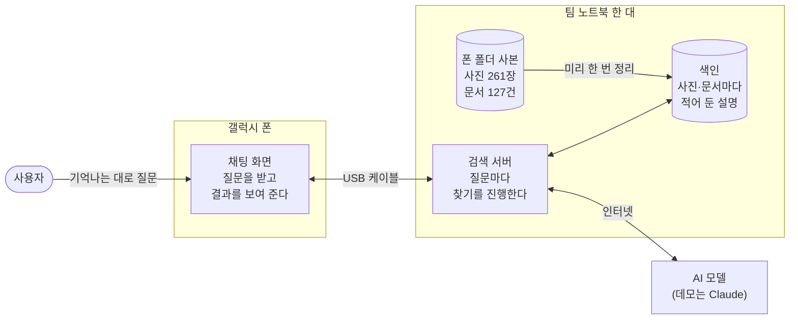
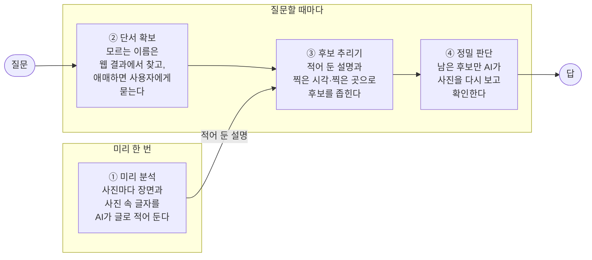
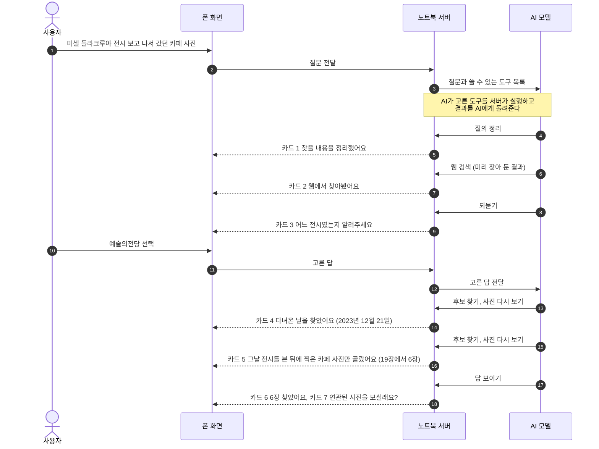
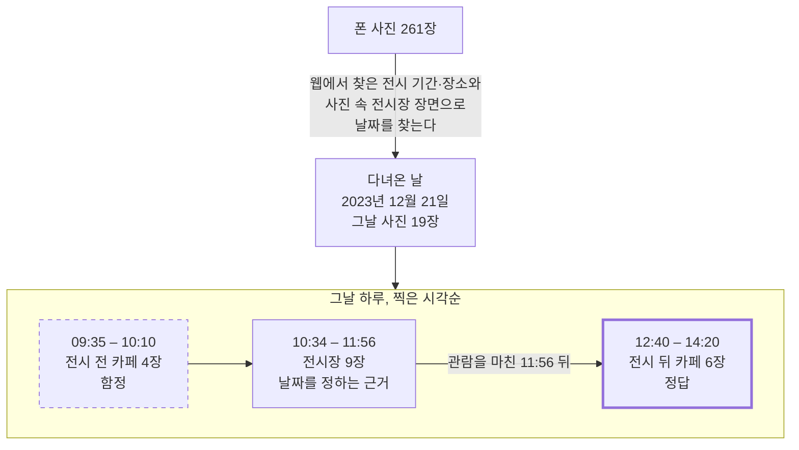
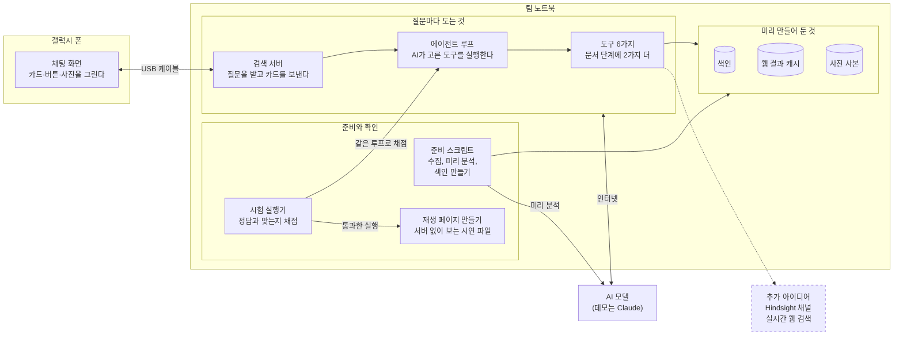
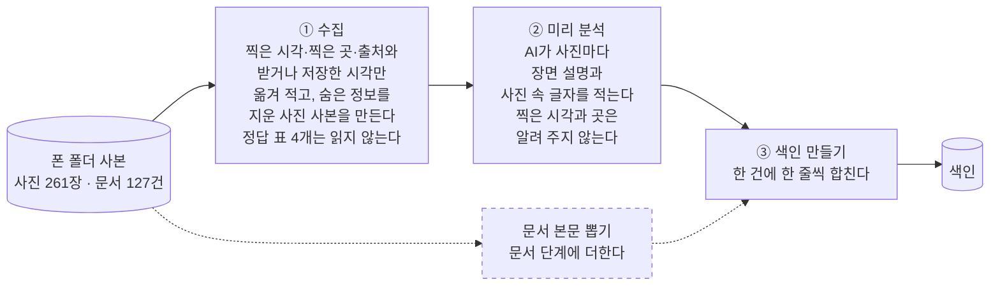
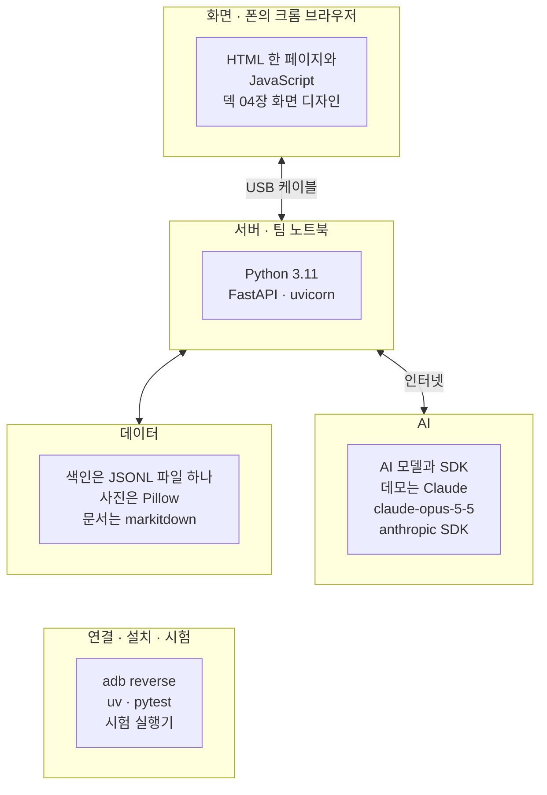
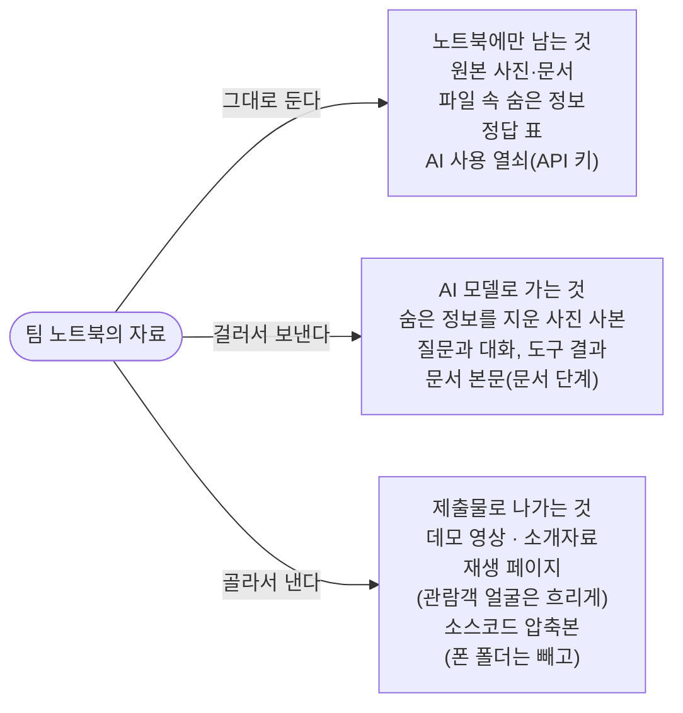
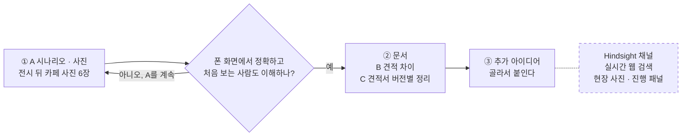
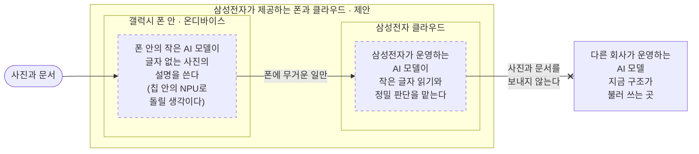

# AI ( ) Dictionary 구조와 기술 스택

AI ( ) Dictionary는 폰의 사진과 문서를 기억나는 대로 물으면 찾아 주는 AI 에이전트입니다. 폰은 화면만 맡고, 팀 노트북의 검색 서버가 미리 만들어 둔 색인과 AI 모델을 묶어 답을 찾습니다.

> 상태: 2026-11-14 기준 설계입니다. 실행 코드는 본선에서 `workspace/`에 만들고, 구조나 이름이 바뀌면 이 문서를 함께 고칩니다.

시연 자료는 갤럭시 폰 폴더를 본뜬 가상 자료(`Mobile Storage/`)이고, 팀 노트북에서 그 사본을 읽습니다. 사진은 전시장 사진 9장만 찍은 시각과 찍은 곳을 시나리오에 맞춰 넣은 실제 사진이고, 나머지는 합성 사진입니다.

1부는 누구나 읽는 발표용 설명이고, 2부는 팀원과 코딩 에이전트가 읽는 개발자 참고입니다.

1. 1부. 발표용 설명
   1. 한눈에 보기
   2. 찾아내는 네 단계
   3. 시연 장면 따라가기
   4. 정답을 골라내는 법
   5. 구성 요소
   6. AI 모델이 쓰는 도구
   7. 미리 해 두는 일
   8. 기술 스택
   9. 실시간인 것과 미리 만든 것
   10. 데이터와 개인정보
   11. 행사장에서 막히면
   12. 만드는 순서와 다음 단계
   13. 용어 풀이
2. 2부. 개발자 참고

## 1부. 발표용 설명

### 1. 한눈에 보기

**폰은 화면, 노트북은 찾기, AI 모델은 판단을 맡습니다.**

**그림 1. 전체 모습**



사용자가 갤럭시 폰의 채팅 화면에 '미셸 들라크루아 전시 보고 나서 갔던 카페 사진'이라고 물으면 카페 사진 6장을 찾아 보여 줍니다. 갤럭시 폰에는 AI 모델도 비밀 열쇠인 API 키도 없으며 채팅 화면만 맡습니다. 찾기는 팀 노트북 한 대의 검색 서버가 진행하고, 폰과 노트북은 USB 케이블로 이어져 와이파이 없이 돕니다. 인터넷은 검색 서버가 판단을 맡은 AI 모델을 부를 때만 씁니다. 노트북의 폰 폴더 사본에는 사진 261장과 문서 127건이 들어 있습니다. 이 자료를 미리 한 번 정리해 찾아보기 목록인 색인을 만들어 둡니다.

### 2. 찾아내는 네 단계

**무거운 분석은 미리 한 번, 질문마다는 가볍게 좁힙니다.**

**그림 2. 찾아내는 네 단계**



찾는 과정은 미리 분석, 단서 확보, 후보 추리기, 정밀 판단의 네 단계로 이어집니다. 미리 한 번 묶음의 미리 분석은 사진과 문서마다 AI 모델이 장면과 글자를 한 번만 적어 두는 무거운 일입니다. 질문할 때마다 묶음의 단서 확보, 후보 추리기, 정밀 판단 세 단계는 질문이 들어올 때마다 차례로 돕니다. 단서 확보는 모르는 이름을 웹 결과에서 찾고, 후보가 여럿이면 사용자에게 되묻습니다. 후보 추리기는 미리 적어 둔 설명과 찍은 시각, 찍은 곳으로 대상을 거르는 가벼운 일입니다. 정밀 판단은 남은 후보 몇십 장 안쪽만 AI 모델이 사진을 다시 보는 단계라 질문할 때마다 사진 261장을 모두 보이지 않습니다.

### 3. 시연 장면 따라가기

**질문 하나에 카드 일곱 장이 차례로 나옵니다.**

**그림 3. 시연 장면**



사용자가 폰 화면에 질문을 넣으면 노트북 서버가 질문과 쓸 수 있는 도구 목록을 AI 모델에 전달합니다. AI 모델이 필요한 기능인 도구를 고르면 노트북 서버가 실행하고 결과를 AI 모델에 돌려줍니다. 노트북 서버는 그 결과로 찾는 과정을 한 단계씩 보여 주는 칸인 카드를 만들어 폰 화면에 나오는 대로 바로 보냅니다. 카드 3의 되묻기에서는 잠시 멈췄다가 사용자가 전시를 고르면 멈춘 자리에서 같은 대화를 잇습니다. 다른 전시를 고르면 그 기간에는 전시장 사진이 없다고 답하고 예술의전당 선택지를 다시 보입니다. 아래 표의 카드 문구는 화면을 만들면서 다듬을 수 있습니다.

| 순서 | 화면 문구 | 하는 일 | 쓰는 도구 |
| --- | --- | --- | --- |
| 1 | '찾을 내용을 정리했어요' | 질문을 찾을 것(카페 사진), 기준(미셸 들라크루아 전시 직후), 아직 모르는 것(언제)으로 나눕니다 | 질의 정리 |
| 2 | '웹에서 찾아봤어요' | 프랑스 나이브아트 화가이고, 국내 전시가 지난 것 네 번과 예정 한 번 있었다는 것을 미리 찾아 둔 웹 결과에서 찾습니다 | 웹 검색 |
| 3 | '어느 전시였는지 알려주세요' | 지난 전시 네 개를 선택지로 보입니다. 예정 전시는 뺍니다. 사용자는 예술의전당을 고릅니다 | 되묻기 |
| 4 | '다녀온 날을 찾았어요' | 전시 기간(2023.12.16–2024.3.31) 안에서 전시장 사진이 있는 날은 2023년 12월 21일 하루입니다. 근거는 전시장 사진 9장과 유리에 적힌 'MICHEL DELACROIX'S EDITION' 글자입니다 | 후보 찾기, 사진 다시 보기 |
| 5 | '그날 전시를 본 뒤에 찍은 카페 사진만 골랐어요' | 관람을 마친 11:56 뒤에 같은 카페에서 찍은 사진만 남깁니다. 그날 사진 19장에서 6장으로 좁힙니다 | 후보 찾기, 사진 다시 보기 |
| 6 | '6장 찾았어요' | 카페 사진 6장을 보여 줍니다. 출처 표시는 6장 모두 갤러리입니다 | 답 보이기 |
| 7 | '연관된 사진을 보실래요?' | '전시장 사진도 보기'(9장, 출처 표시 다운로드)와 '그날 사진 전부 보기'(19장, 찍은 시각순) 버튼을 보입니다 | 후보 찾기, 답 보이기 |

카드 3에서 보여 주는 지난 전시 네 개는 예술의전당(2023.12–2024.3), 롯데백화점 잠실점 에비뉴엘(2024.11–2025.2), 현대백화점 무역센터점(2025.5–2025.8, 시작 월 추정), 송도 트리플스트리트(2025.12–2026.2)입니다.

### 4. 정답을 골라내는 법

**같은 날 카페가 두 곳, 찍은 시각이 답을 가릅니다.**

**그림 4. 정답을 골라내는 법**



폰 사진 261장에서 웹에서 찾은 전시 기간과 사진 속 전시장 장면으로 찾은 다녀온 날은 2023년 12월 21일이고, 그날 사진 19장이 있습니다. 그날 하루를 찍은 시각순으로 놓으면 점선 상자인 전시 전 카페 4장(09:35–10:10, 전시장에서 268m)과 전시장 9장(10:34–11:56)이 먼저 나옵니다. 이어서 굵은 테두리 상자인 전시 뒤 카페 6장(12:40–14:20, 전시장에서 약 2.8km)이 나옵니다. 오전 카페는 전시 전이라 함정이고, 관람을 마친 11:56 뒤에 찍은 오후 카페가 정답입니다.

카페 사진은 사용자가 폰으로 찍었다는 설정이라 갤러리에 있고, 전시장 9장은 친구가 올린 사진을 내려받았다는 설정이라 다운로드 폴더에 있습니다. 출처가 다른 사진을 찍은 시각으로 이어 붙여야 '전시를 본 뒤'를 알 수 있습니다. 사진을 고르는 기준은 찍은 시각, 찍은 곳, 카페 장면입니다. 찻주전자나 전시 엽서는 카페를 설명하는 말일 뿐 고르는 기준이 아닙니다(엽서가 보이는 사진은 6장 가운데 3장뿐입니다). 다른 날 찍은 카페, 빵집, 디저트 가게 사진 29장도 함정으로 섞여 있습니다.

### 5. 구성 요소

**노트북 안에서 질문마다 도는 것과 미리 만들어 두는 것을 나눕니다.**

**그림 5. 구성 요소**



갤럭시 폰에는 채팅 화면만 있고, 팀 노트북 안은 질문마다 도는 것, 미리 만들어 둔 것, 준비와 확인의 세 묶음으로 나뉩니다. 질문마다 도는 것에서는 검색 서버가 되풀이 구조인 에이전트 루프를 돌려 도구를 실행합니다. 도구는 미리 만들어 둔 것의 색인, 웹 결과 캐시, 사진 사본을 읽습니다. 인터넷 너머의 AI 모델을 부르는 곳은 노트북의 검색 서버, 준비 스크립트, 시험 실행기 세 곳뿐이고 갤럭시 폰은 부르지 않습니다. 준비와 확인 묶음의 시험 실행기는 검색 서버와 같은 에이전트 루프로 채점하고, 정답과 맞은 통과한 실행만 재생 페이지 만들기로 넘깁니다. 점선 상자인 추가 아이디어는 기본 동작이 완성된 뒤 붙일 확장 기능입니다.

| 구성 요소 | 하는 일 | 어디서 도나 |
| --- | --- | --- |
| 채팅 화면 | 질문을 보내고, 서버가 보낸 카드, 선택 버튼, 결과 사진을 그립니다. 판단은 하지 않습니다 | 폰의 크롬 브라우저 |
| 검색 서버 | 질문마다 찾기를 진행하고 카드가 나오는 대로 폰에 보냅니다 | 팀 노트북 |
| 에이전트 루프 | AI 모델이 고른 도구를 서버가 실행하고 결과를 돌려주기를 답이 나올 때까지 되풀이합니다. 되묻기에서 멈췄다가 답이 오면 잇습니다 | 팀 노트북 |
| 도구 | 질의 정리부터 답 보이기까지 여섯 가지입니다. 문서 단계에 두 가지를 더합니다 | 팀 노트북 |
| 색인 | 사진과 문서마다 찍은 시각(문서는 작성일), 찍은 곳, 출처, AI가 적은 설명을 한 줄씩 담은 파일입니다 | 팀 노트북 |
| 웹 결과 캐시 | 미리 찾아 둔 전시 정보(기간, 장소, 장소 좌표)입니다 | 팀 노트북 |
| 사진 사본 | 숨은 정보를 지운 사진입니다. AI 모델에 보내는 것과 화면에 보이는 것 두 가지입니다 | 팀 노트북 |
| 준비 스크립트 | 수집, 미리 분석, 색인 만들기를 맡습니다. 문서 단계에 문서 본문 뽑기를 더합니다 | 팀 노트북, 미리 한 번 |
| 시험 실행기 | 질문을 넣고 결과가 정답과 맞는지 명령줄에서 채점합니다 | 팀 노트북 |
| 재생 페이지 | 정답과 맞은 실행을 서버 없이 다시 보여 주는 파일 하나입니다. 시연이 막혔을 때와 제출에 씁니다 | 아무 컴퓨터의 브라우저 |
| AI 모델 | 도구 고르기, 사진 설명 쓰기, 사진 다시 보기를 맡습니다 | 인터넷 너머(데모는 Claude) |
| Hindsight 채널(추가 아이디어) | 팀이 따로 받아 둔 기억 저장소 서버를 두 번째 검색 경로로 붙입니다 | 붙일 때 정합니다 |

### 6. AI 모델이 쓰는 도구

**AI 모델은 도구를 고르고, 실행은 노트북의 코드가 합니다.**

AI 모델은 질문에 맞춰 여섯 가지 도구(문서를 다루는 문서 단계에서는 여덟 가지) 가운데 필요한 것을 차례로 고릅니다. 거리, 시각, 금액 계산은 AI 모델이 어림잡지 않고 노트북의 코드가 합니다. 자료에 캘린더 기록이 없으므로 일정을 찾는 도구는 없습니다. 전시장 근처는 웹 결과에 적어 둔 장소 좌표에서 1km 안으로 보는데, 그 안에 오전 카페(268m)도 들어서 찍은 곳만으로 정하지 않고 사진 속 전시장 장면과 함께 봅니다. 코드와 AI 지시문에 이 시나리오의 질문 문구, 날짜, 장소 이름을 적지 않으므로 다른 질문에도 같은 도구로 답합니다.

| 도구 | 하는 일 | 화면 |
| --- | --- | --- |
| 질의 정리 | 질문을 찾을 것, 기준, 둘의 관계, 아는 것과 모르는 것으로 나눕니다. 맨 먼저 씁니다 | 카드 1 |
| 웹 검색 | 모르는 이름을 찾습니다. 기본 설정에서는 미리 찾아 둔 결과로 답하고, 화면에 그렇다고 밝힙니다 | 카드 2 |
| 되묻기 | 후보가 둘 이상이면 선택지를 보이고 사용자의 답을 기다립니다 | 카드 3 |
| 후보 찾기 | 색인에서 기간, 시각, 거리, 사진 속 글자, 장면 설명으로 후보를 좁힙니다 | 카드 4와 5의 숫자, 카드 7의 사진 |
| 사진 다시 보기 | 남은 후보만 AI 모델이 사진을 다시 보고 조건에 맞는지 판단합니다 | 카드 4와 5의 근거 |
| 답 보이기 | 찾은 답을 화면에 냅니다. 마지막에 한 번 씁니다 | 카드 6과 7 |
| 문서 읽기(문서 단계) | 견적서 같은 문서에서 업체, 금액, 날짜, 버전 문구를 읽습니다 | B와 C의 답 카드 |
| 계산(문서 단계) | 뺄셈, 합계, 비율을 코드로 합니다 | B의 답 카드 |

### 7. 미리 해 두는 일

**사진마다 AI가 설명을 미리 적어 두고, 숨은 정보는 지웁니다.**

**그림 6. 미리 해 두는 일**



준비 스크립트는 폰 폴더 사본의 원본을 고치지 않고 수집, 미리 분석, 색인 만들기 순서로 실행합니다. 수집은 찍은 시각, 찍은 곳, 출처와 받거나 저장한 시각만 옮겨 적고 파일 안에 함께 저장된 숨은 정보(위치, 기기, 메모 등)를 지운 사진 사본을 만듭니다. 미리 분석에서는 AI 모델이 사진마다 장면 설명과 사진 속 글자를 적고, 이때 찍은 시각과 찍은 곳은 알려 주지 않습니다. 색인 만들기는 이 결과를 한 건에 한 줄씩 합쳐 388줄짜리 색인을 만들므로 별도 데이터베이스가 필요 없습니다. 점선 상자인 문서 본문 뽑기는 문서 단계에 더합니다.

숨은 정보를 지우는 까닭은 그날 사진 19장의 파일 속에 '예술의전당' 같은 장소 이름이 들어 있어서, 그대로 두면 AI 모델이 사진을 보지 않고도 답을 알게 되기 때문입니다. 같은 이유로 자료에 함께 들어 있는 정답 표 4개도 읽지 않습니다. 미리 분석에서 한 번 적은 설명은 저장해 두고 다시 만들지 않는데, 다시 만들면 돈이 들고 결과가 바뀌기 때문입니다.

### 8. 기술 스택

**노트북 한 대로 돌릴 수 있는 가장 작은 구성을 골랐습니다.**

**그림 7. 기술 스택**



기술 구성은 화면, 서버, AI, 데이터, 연결·설치·시험의 다섯 층으로 나뉩니다. 화면 층의 HTML 한 페이지와 JavaScript는 USB 케이블로 팀 노트북의 Python 3.11, FastAPI, uvicorn 서버와 이어집니다. 데이터 층은 색인을 JSONL 파일 하나에 담고 사진은 Pillow로, 문서는 markitdown으로 다룹니다. 연결·설치·시험 층은 adb reverse로 폰을 잇고 uv, pytest, 시험 실행기로 설치와 채점을 맡습니다. AI 층의 AI 모델은 도구를 골라 부를 줄 아는 모델이면 AI를 부르는 코드만 바꿔 끼울 수 있는 자리입니다. 쓰는 도구의 판 번호는 처음 설치할 때 잠금 파일로 고정하고 행사 중에는 올리지 않습니다.

| 부분 | 고른 것 | 쉬운 설명 | 고른 이유 |
| --- | --- | --- | --- |
| 화면 | HTML 한 페이지와 JavaScript, 발표 덱 04장의 화면 디자인 | 폰 크롬에서 여는 웹 페이지 한 장 | 앱을 깔지 않아도 되고 빌드 단계가 없습니다. 재생 페이지가 같은 그리기 코드를 씁니다 |
| 서버 | Python 3.11, FastAPI, uvicorn | 노트북에서 도는 작은 웹 서버 | 본선 안에 만들 수 있는 작은 서버이고, 카드를 나오는 대로 폰에 이어 보낼 수 있습니다(SSE). 노트북 밖에서는 접속할 수 없게 엽니다 |
| AI 모델 | 데모는 Claude(`claude-opus-5-5`), anthropic SDK | 질문을 이해하고 도구를 고르고 사진을 보는 AI | 사진 설명과 찾기에 같은 모델을 써서 설명 형식이 같고 API 키 하나로 끝납니다 |
| 색인 | JSONL 파일 하나 | 한 줄에 사진이나 문서 하나를 적은 글 파일 | 388줄뿐이라 데이터베이스 없이 메모리에서 거릅니다 |
| 사진 처리 | Pillow | 사진 사본을 만드는 도구 | 사진을 바로 세우고 숨은 정보를 지운 사본을 만듭니다 |
| 문서 읽기 | markitdown 0.1.7 | pdf, xlsx, pptx, docx, html에서 글자를 뽑는 도구 | 이 판으로 문서 127건 모두 글자가 뽑혔습니다(11/14 시험) |
| 폰 연결 | USB 케이블과 adb reverse | 폰 크롬에서 노트북 서버를 여는 방법 | 와이파이 없이 돕니다 |
| 설치와 시험 | uv, pytest, 시험 실행기 | 같은 판으로 설치하고, 작은 기능을 시험하고, 정답과 맞춰 채점합니다 | 누가 받아도 같은 판으로 깔리고, 결과를 정답과 비교할 수 있습니다 |

### 9. 실시간인 것과 미리 만든 것

**질문 처리는 실시간이고, 설명과 웹 결과는 미리 만들어 둡니다.**

대회 규칙이 실시간인 부분과 시뮬레이션인 부분을 밝히라고 정하고 있어 두 영역을 아래 표로 분명히 나눕니다. 질문을 이해해 도구를 고르고 후보를 계산하며 사진을 다시 보는 과정은 질문할 때마다 실시간으로 돕니다. 미리 만든 사진 설명, 웹 결과, 저장한 실행은 재생 페이지 화면과 데모 영상 자막에도 함께 밝힙니다.

| 부분 | 실시간인가 | 밝히는 곳 |
| --- | --- | --- |
| 질문 이해, 도구 고르기, 사진 다시 보기 | 실시간입니다. 질문할 때마다 AI 모델을 부릅니다 | 없음 |
| 후보 찾기, 거리와 시각 계산 | 실시간입니다. 노트북의 코드가 계산합니다 | 없음 |
| 되묻기와 사용자의 선택 | 실시간입니다 | 없음 |
| 사진마다 적어 둔 설명 | 미리 만든 것입니다. 한 번 만들어 저장해 두고 씁니다 | 재생 페이지 화면, 영상 자막 |
| 웹 결과(들라크루아 국내 전시 다섯 건) | 미리 찾아 둔 것입니다. 기본 설정에서 웹 검색은 이 결과로 답합니다 | 카드 2, 재생 페이지 화면, 영상 자막 |
| 재생 페이지와 데모 영상의 실행 | 정답과 맞은 실행을 저장해 다시 보여 줍니다 | 재생 페이지 화면, 영상 자막 |
| 영상 앞부분의 갤러리 검색 장면 | 재현 화면입니다 | 영상에서 재현 화면이라고 밝힙니다 |
| 폰 폴더 자료 | 가상 자료입니다. 전시장 사진 9장만 실제 사진이고, 그 찍은 시각과 찍은 곳도 시나리오에 맞춰 넣었습니다 | 이 문서 첫머리 |

### 10. 데이터와 개인정보

**원본과 열쇠는 노트북에 남기고, 걸러서 보냅니다.**

**그림 8. 데이터가 가는 곳**



팀 노트북의 자료는 노트북에만 남는 것, AI 모델로 가는 것, 제출물로 나가는 것의 세 갈래로 관리합니다. 원본 사진과 문서, 파일 속 숨은 정보, 정답 표, AI 사용 열쇠(API 키)는 노트북에만 남기고 그대로 둡니다. AI 모델로 가는 것은 숨은 정보를 지운 사진 사본, 질문과 대화, 도구 결과, 문서 단계의 문서 본문뿐이며 걸러서 보냅니다. 제출물로 나가는 것은 데모 영상, 소개자료, 관람객 얼굴을 흐리게 처리한 재생 페이지, 소스코드 압축본으로 골라서 냅니다. 전시장 사진 9장에 관람객 얼굴이 그대로 있으므로 소스코드 압축본에는 폰 폴더를 넣지 않습니다. 또한 API 키는 화면, 재생 페이지, 실행 기록, 로그에 넣지 않으며, 검색 서버는 노트북 밖에서 접속할 수 없게 엽니다.

### 11. 행사장에서 막히면

**막혀도 시연이 끊기지 않게 대비해 둡니다.**

행사장의 인터넷 연결이 불안정하거나 AI 모델 호출이 실패하더라도 발표 시연이 멈추지 않도록 상황별 대처 방법을 마련해 둡니다. 특히 인터넷과 검색 서버 없이도 동작하는 재생 페이지를 준비해 현장 장애가 생겨도 같은 시연 흐름을 이어서 보여 줍니다.

| 상황 | 대처 |
| --- | --- |
| 행사장 망에서 AI 모델이 불리지 않는다 | 노트북을 휴대폰 핫스팟에 잇습니다. 행사장 망은 미리 확인합니다 |
| 와이파이가 없다 | 폰과 노트북은 USB 케이블로 이어져 있어 상관없습니다. 노트북이 AI 모델을 부를 인터넷만 있으면 됩니다 |
| 시연 중에 AI 모델 호출이 실패한다 | 화면에 오류 카드가 뜹니다. 발표자가 재생 페이지 파일을 열어 같은 장면을 이어 보여 줍니다. 화면이 재생 페이지로 저절로 넘어가지는 않습니다 |
| 인터넷이 아예 없다 | 재생 페이지는 인터넷 없이 처음부터 끝까지 돕니다 |
| 실시간 웹 검색(추가 아이디어)을 붙였는데 막힌다 | 미리 찾아 둔 결과로 돌립니다 |

### 12. 만드는 순서와 다음 단계

**A 장면을 먼저 완성하고, 문서와 추가 아이디어로 넓힙니다.**

**그림 9. 만드는 순서**



개발은 사진 찾기인 A 시나리오를 먼저 완성한 뒤 문서 단계와 추가 아이디어로 넓혀 갑니다. A 시나리오가 폰 화면에서 정확하고 처음 보는 사람도 이해할 수 있을 때까지는 다음 단계로 가지 않습니다. 문서 단계의 B 시험('욕실 견적 중에 제일 싼 데랑 계약한 데 얼마 차이야?')은 공급가 70만 원 차이와 부가세 포함 77만 원을 함께 보여 줍니다. C 시험('견적서 버전별로 정리해줘')은 주방, 욕실, 달뜰코스메틱 세 묶음과 최신판 표시를 보여 줍니다. 점선 상자인 추가 아이디어는 Hindsight 채널, 실시간 웹 검색, 현장 사진 올리기, 진행 패널이며 남은 시간에 골라서 붙입니다.

그 뒤의 방향은 발표 덱 09장을 따라 폰 안의 갤러리, 파일, 카카오톡 받은 파일에서 시작해 메일과 SNS 계정 연결, 기업 간 제휴 순으로 넓힙니다. 이어서 PC(갤럭시 북)로 나아가며, 이 방향은 앞으로의 확장 구상이라 이번 본선에서 만드는 범위는 아닙니다.

### 13. 용어 풀이

**이 문서에 나오는 말을 쉬운 말로 풀었습니다.**

| 말 | 뜻 |
| --- | --- |
| AI 에이전트 | 질문을 받아 필요한 도구를 스스로 골라 쓰며 답까지 찾아오는 프로그램입니다. 이 제품 전체를 말합니다 |
| AI 모델 | 글과 사진을 이해하는 AI입니다. 이 제품에서는 도구를 고르고 사진을 판단합니다. 데모는 Claude입니다 |
| 도구 | AI 모델이 부를 수 있는 기능 하나입니다. 실행은 노트북의 코드가 합니다 |
| 에이전트 루프 | AI 모델이 도구를 고르고 서버가 실행해 결과를 돌려주는 일을 답이 나올 때까지 되풀이하는 것입니다 |
| 색인 | 사진과 문서마다 찍은 시각(문서는 작성일), 찍은 곳, 출처, AI가 적은 설명을 한 줄씩 모은 파일입니다. 책 뒤의 찾아보기와 같습니다 |
| 미리 분석 | AI 모델이 사진마다 장면과 사진 속 글자를 미리 한 번 글로 적어 두는 일입니다 |
| 숨은 정보 | 사진과 문서 파일 안에 함께 저장된 찍은 시각, 위치, 기기, 메모 같은 정보입니다. 화면에서는 '찍은 시각', '찍은 곳'이라고 부릅니다 |
| 웹 결과 캐시 | 웹에서 미리 찾아 저장해 둔 결과입니다. 시연 중 인터넷 사정과 상관없이 같은 결과를 냅니다 |
| 되묻기 | 후보가 여럿일 때 사용자에게 선택지를 보이고 고르게 하는 것입니다 |
| 카드 | 채팅 화면에 차례로 나오며 찾는 과정을 한 단계씩 보여 주는 칸입니다 |
| 재생 페이지 | 정답과 맞은 실행을 서버 없이 그대로 다시 보여 주는 html 파일 하나입니다 |
| 시험 실행기 | 질문을 넣고 결과가 정답과 맞는지 자동으로 채점하는 프로그램입니다 |
| API 키 | AI 모델을 쓸 수 있게 해 주는 비밀 열쇠입니다. 노트북의 설정 파일에만 둡니다 |
| adb reverse | 폰 크롬에서 USB 케이블로 이은 노트북의 서버를 열게 해 주는 연결 방법입니다 |
| SSE | 서버가 연결 하나로 결과를 나오는 대로 이어 보내는 방식입니다. 카드가 한 장씩 나타나는 까닭입니다 |
| JSONL | 한 줄에 기록 하나를 적는 글 파일 형식입니다. 색인이 이 형식입니다 |
| A, B, C | 시험 질문 세 개입니다. A는 전시 뒤 카페 사진, B는 욕실 견적 차이, C는 견적서 버전별 정리입니다 |
| 문서 단계 | A가 통과한 뒤 문서를 색인에 넣고 B와 C를 붙이는 단계입니다 |
| Hindsight 채널 | 추가 아이디어입니다. 팀이 따로 받아 둔 기억 저장소 서버를 두 번째 검색 경로로 붙이는 것입니다 |

---

## 2부. 개발자 참고

2부는 팀원과 코딩 에이전트가 읽는다. 폴더, 파일, 도구, 필드, 환경 변수, 명령은 코드에 쓰는 이름 그대로 적었다. 코딩 에이전트는 저장소의 AGENTS.md(작업 규칙)와 2부(구조)를 먼저 읽는다. 2부는 팀의 '본선 실행 계획' 문서(2026-11-14 판)의 '아키텍처와 기술 스택' 절을 옮긴 것이고, 실행 코드는 아직 없다. 카드 문구와 도구 입출력은 할 일 7에서 확정해 더한다. 이름이나 구조를 바꾸면 이 문서를 고치고, 계획 문서의 같은 절은 사람이 맞춘다. 1부의 그림과 2부의 이름이 다르면 2부를 따른다.

### 2부에 나오는 말

- 이 제품: 폰의 사진과 문서를 기억나는 대로 물으면 찾아 주는 검색 에이전트다.
- 덱: 저장소 맨 위의 발표 덱 AI_Dic_hackathon_presentation.html이다. 04장에 A의 채팅 화면이 있다.
- A, B, C: 시험 질의 세 개다. A는 덱 04장의 질의로, 전시를 보고 나서 간 카페의 사진을 찾는다. B는 '욕실 견적 중에 제일 싼 데랑 계약한 데 얼마 차이야?', C는 '견적서 버전별로 정리해줘'다.
- A 단계와 문서 단계: A 단계는 A를 준비하고 완성하는 단계(할 일의 1, 2단계)다. 문서 단계는 3단계로, A가 통과한 뒤 문서를 색인에 넣고 B와 C를 붙인다.
- A 다듬기: A가 통과한 뒤 골라서 붙이는 장면 보강 네 가지(가, 나, 다, 라)다. 하지 않아도 A는 완성이다.
- 추가 아이디어: 문서 단계가 통과한 뒤 시간이 남는 만큼 붙이는 질의와 기능이다. 2부에서는 hindsight 채널, 현장 사진 올리기, 실시간 웹 검색, 진행 패널이 추가 아이디어다.
- 카드: A 화면에 차례로 나오는 일곱 장이다. 다녀온 날 카드는 4번('다녀온 날을 찾았어요'), 고른 이유 카드는 5번('그날 전시를 본 뒤에 찍은 카페 사진만 골랐어요')이다.
- 정답 표와 정답 키: 정답 표는 폰 폴더에 함께 들어 있는 정답 목록이다. 정답 키는 팀이 채점용으로 만드는 eval/answer_key.json이다.
- 할 일 N: 팀의 '본선 실행 계획' 문서에 있는 '제출까지 해야 할 일' 목록의 N번 일이다. 그 목록은 이 문서에 옮기지 않았다. '정한 것' 표도 같은 계획 문서에 있고, 팀이 정한 것을 모은 표다.

### 흐름: 미리 한 번, 질의마다

이 흐름은 1부의 그림 2(찾아내는 네 단계)와 그림 6(미리 해 두는 일)에 그렸다. 그림 2의 '미리 한 번' 묶음은 미리 한 번 돌리고, '질문할 때마다' 묶음은 질의마다 돈다. 덱 08장의 네 단계 가운데 미리 분석이 앞의 묶음이고, 단서 확보, 후보 추리기, 정밀 판단 세 단계가 뒤의 묶음이다. 서버는 색인에서 후보를 좁힌 뒤 상위 후보만 Claude가 다시 본다.

A에 필요한 도구는 여섯 개다. 질의 정리, 웹 검색, 되묻기, 후보 찾기, 사진 다시 보기, 답 보이기다. 답 보이기는 찾은 답을 화면에 내는 도구라서 Claude가 마지막에 한 번 부른다. 문서 단계에서 문서 읽기와 계산 두 개를 더한다. 데이터에 캘린더 기록이 없어 일정을 찾는 도구는 만들지 않는다. 전시장 위치는 웹 결과를 캐시할 때 함께 적은 장소 좌표로 안다(할 일 2). 후보 찾기는 이 좌표에서 1km 안을 전시장 근처로 본다. 1km 안에는 전시장 밖에서 찍은 사진도 든다(A에서는 268m 떨어진 오전 카페 4장). 그래서 전시장 사진인지는 찍은 곳과 전시장 장면을 함께 보고 정한다. 좌표를 코드와 지시문에 적지 않는다.

### 구성 요소와 배치

폰, 팀 노트북, Claude API가 맡는 일은 1부의 그림 1(전체 모습)과 그림 5(구성 요소)에 그렸다.

폰은 화면만 맡는다. 폰에는 모델과 API 키가 없고, 케이블과 adb reverse로 노트북 서버에 붙는다. Claude API는 노트북에서만 부른다. 부르는 곳은 서버, 시험 실행기, 미리 돌리는 스크립트다. 행사장에서는 이 노트북 한 대로 시연한다.

| 구성 요소 | 하는 일 | 기술 | 코드 |
| --- | --- | --- | --- |
| 채팅 화면 | 질의를 보내고, 서버가 보낸 카드, 되묻기 버튼, 결과, 연관 사진 버튼을 그린다. 판단은 하지 않는다 | HTML 한 페이지와 자바스크립트(빌드 없음), 덱 04장 CSS | `web/` |
| 서버 | 질의마다 에이전트 루프를 돌리고 카드가 나오는 대로 폰에 보낸다. 화면용 사진 사본을 내주고 실행 기록을 남긴다 | Python 3.11, FastAPI, uvicorn | `app/main.py` |
| 에이전트 루프 | Claude가 도구를 골라 부르면 서버가 실행하고 결과를 돌려준다. 되묻기에서 멈췄다가 답이 오면 같은 대화를 잇는다 | anthropic SDK, 직접 짠 루프 | `app/loop.py` |
| 도구 | 아래 '도구' 소절의 여덟 개(A에 여섯, 문서 단계에 둘) | Python | `app/tools/` |
| 웹 캐시 | 고유명사의 소개 한 줄과, 전시 같은 행사의 기간, 장소, 좌표, 출처 주소. 기본 설정(cache)에서 웹 검색 도구가 이것으로 답한다 | JSON 파일 | `data/web_cache.json` |
| 색인 | 사진 261장과 문서 127건을 한 줄씩 담는다. 서버가 시작할 때 메모리에 올린다 | JSONL(한 줄에 JSON 하나) 파일 | `var/index.jsonl` |
| 사진 사본 | 수집 때 만든다. 회전 정보대로 세우고 메타데이터를 모두 뺀 사본이다. Claude용은 원본 크기, 화면용은 긴 변 1280픽셀이고, 둘 다 JPEG(품질 90)다 | Pillow | `var/photos/model/`, `var/photos/screen/` |
| 미리 돌리는 스크립트 | 수집(카탈로그와 사진 사본), 미리 분석, 문서 본문 뽑기, 색인 만들기 | Pillow, markitdown, anthropic SDK | `pipeline/` |
| 시험 실행기 | 정답 키로 A, B, C를 명령줄에서 채점하고 실행 기록을 남긴다. 서버와 같은 루프를 쓴다 | Python | `eval/` |
| 재생 페이지 만들기 | 통과한 실행(eval/passed/)을 서버 없이 보이는 html 파일 하나(var/replay.html)로 묶는다. 화면과 같은 그리기 코드를 쓴다 | Python | `replay/` |
| Claude API | 에이전트 루프, 사진 설명, 사진 다시 보기, 설명에서 고르기, 문서 읽기, 실시간 웹 검색(추가 아이디어) | claude-opus-5-5 | 밖 |
| hindsight 채널 | 추가 아이디어다. 팀이 포크해 둔 기억 저장소 서버를 두 번째 검색 경로로 붙인다 | 별도 프로세스 | 붙일 때 정한다 |

코드 칸의 경로는 모두 workspace/ 안이다.

### 기술 스택

| 부분 | 고른 것 | 이유와 메모 |
| --- | --- | --- |
| 언어와 환경 | Python 3.11, uv | uv가 가상환경과 잠금 파일(uv.lock)을 만든다. FastAPI와 Pillow 최신판이 3.11 이상을 요구한다 |
| 서버 | FastAPI, uvicorn | 127.0.0.1:8000에만 묶는다. 화면에는 SSE(서버가 연결 하나로 이벤트를 이어 보내는 방식)로 보낸다 |
| Claude 호출 | anthropic 2.x | 11/10에 나온 2.8.0이 최신이다. 2.x는 API 버전 2026-10-21을 보낸다. 모델은 claude-opus-5-5 하나다. 거절되면 대체 모델이 답할 수 있다(아래 'Claude 호출 규칙') |
| 사진 | Pillow | 사진 261장은 JPEG 253장, PNG 5장, MPO 3장(본 사진 뒤에 보조 이미지가 붙은 JPEG)이다. 긴 변이 모두 2016픽셀 이하라 줄이지 않는다. HEIC가 없어 pillow-heif는 넣지 않는다 |
| 문서 | markitdown[pdf,docx,xlsx,pptx] 0.1.7 | 이 판으로 문서 127건 모두 글자가 뽑혔다(11/14). 최신은 0.1.9지만 시험한 판으로 고정한다. 대괄호 안의 확장 네 개를 함께 깔아야 pdf, docx, xlsx, pptx가 변환된다 |
| 색인 | JSONL 파일 하나 | 388줄이라 데이터베이스 없이 메모리에서 거른다. 두 좌표 사이 거리는 코드로 계산한다 |
| 화면 | HTML 한 페이지와 자바스크립트, 덱 04장 CSS | 빌드 단계가 없다. 재생 페이지가 같은 그리기 코드를 쓴다 |
| 설정 | python-dotenv | 서버와 스크립트가 시작할 때 dotenv_values로 workspace/.env를 읽는다. Anthropic 클라이언트에는 그 값의 ANTHROPIC_API_KEY를 api_key로, https://api.anthropic.com을 base_url로 직접 넘긴다. 셸에 남은 ANTHROPIC_API_KEY, ANTHROPIC_AUTH_TOKEN, ANTHROPIC_BASE_URL은 쓰지 않는다. .env에 키가 없으면 바로 멈춘다 |
| 시험 | pytest, 시험 실행기 | pytest는 시각, 거리, 금액 읽기 같은 작은 함수를 본다. A, B, C는 시험 실행기가 정답 키로 본다 |
| 폰 연결 | adb reverse | 폰 크롬에서 http://localhost:8000을 연다. 와이파이 없이 돈다 |

판 번호는 11/14에 PyPI에서 본 것이다. 처음 설치할 때 uv.lock으로 고정하고, 행사 중에는 올리지 않는다.

### 질의 한 번이 도는 길

1. 폰 화면이 `POST /api/ask`로 질의를 보낸다. 서버는 실행 번호(run_id)를 만들고 응답을 SSE로 연다. 실행은 한 번에 하나만 돈다.
2. 서버는 지시문, 도구 목록, 첫 사용자 메시지(오늘 날짜와 질의)로 Claude를 부른다.
3. Claude가 도구를 부르면 서버가 실행하고, 도구 입력과 결과로 카드를 만들어 바로 폰에 보낸다. 도구 결과는 같은 대화에 붙여 다시 Claude를 부른다. 카드는 도구 호출마다 한 장이 아니다. 어느 호출이 몇 번 카드가 되는지는 아래 '카드 만드는 규칙'을 따른다.
4. 되묻기가 불리면 서버는 선택지를 보내고 대화를 저장한 채 멈춘다. 폰에서 고르면 `POST /api/answer`로 오고, 서버가 같은 대화에 고른 답을 붙여 잇는다.
5. Claude가 답 보이기를 부르면 서버가 결과와 연관 사진 버튼을 보낸다. Claude가 차례를 마치면 실행이 끝나고, 서버는 실행 기록을 `var/runs/`에 쓴다. 답 보이기 없이 차례를 마치면 'Claude 호출 규칙'대로 한 번 다시 부른다.

시험 실행기는 1번 대신 질의를 바로 넣는다. 정답 키의 되묻기 답은 묻는 차례대로 적은 말의 목록이다. 실행기는 ask 이벤트가 올 때마다 목록의 다음 말이 label에 든 선택지를 고르고, label에 없으면 detail에서 찾아 그 id로 답한다. 맞는 선택지가 없거나 둘 이상이면 그 실행은 실패다. 선택지 id는 실행마다 Claude가 지으므로 정답 키에 적지 않는다. 다른 전시를 고르는 실행은 정답 키에 `A_other`로 적고 되묻기 답 목록을 셋 둔다(목록마다 다른 전시 하나와 예술의전당). `uv run python -m eval.run A_other`는 세 목록을 한 번씩 돌린다. 나머지는 서버와 같은 코드가 돈다.

### 도구

이름과 입출력의 처음 안이다. 할 일 7에서 카드 문구와 함께 확정한다. 도구 정의는 모두 엄격 모드(strict)로 두고, 서버는 받은 사진과 문서 id가 색인에 있는지 다시 확인한다.

| 도구(코드 이름) | 하는 일 | 받는 것 | 돌려주는 것 | 화면 |
| --- | --- | --- | --- | --- |
| 질의 정리(`plan_query`) | 질의를 찾는 것, 기준이 되는 일, 둘의 관계, 아는 것과 모르는 것으로 나눈다. 맨 먼저 부른다 | target, anchor, relation(before, after, same_day, none), known, unknown | 받은 값 그대로 | 찾을 내용을 정리했어요 |
| 웹 검색(`search_web`) | 모르는 고유명사를 찾는다. AIDIC_WEB_SEARCH가 cache(기본)면 웹 캐시로만 답한다. 검색어에 캐시 항목의 별칭 하나가 들어 있으면 그 항목을 돌려주고, 대소문자와 띄어쓰기는 가리지 않는다. 맞는 항목이 없으면 found를 false로, events를 빈 목록으로 돌려준다. live(추가 아이디어)면 실제로 검색한다 | query | found, summary(고유명사 소개 한 줄), events(name, venue, start, end, status(past, upcoming), lat, lon, url), cached(캐시에서 왔는지) | 웹에서 찾아봤어요. 캐시면 미리 찾아 둔 결과라고 밝힌다 |
| 되묻기(`ask_user`) | 실제 후보가 둘 이상일 때 선택지를 보이고 멈춘다 | question, options(id, label, detail) | 사용자가 고른 id | 어느 전시였는지 알려주세요 |
| 후보 찾기(`find_candidates`) | 색인에서 기간, 시각, 거리, 사진 속 글자, 장면 설명으로 후보를 좁힌다. 장면 설명으로 고를 때는 Claude를 한 번 부른다 | date_from, date_to, after, before, near(lat, lon, radius_m), text, about, kinds, limit, card, sentence. radius_m이 빠지면 서버가 1000(1km)으로 채운다. after와 before는 색인의 time과 같은 꼴로 초까지 받고, 그 시각에 찍은 사진은 넣지 않는다 | 조건에 맞는 수, 날짜별 장수(날짜마다 조건에 맞는 장수와 그날 전체 장수), 후보 목록(id, 초까지 적은 시각과 시각의 종류, 거리, 출처, 장면 요약). date_from과 date_to가 같은 날이면 그날 사진 전부의 id를 찍은 시각순으로 더한다. 찍은 곳별 사진 묶음은 A 다듬기의 가, 나, 다를 붙일 때만 더한다 | 다녀온 날 카드와 고른 이유 카드의 숫자, 연관 사진 버튼의 사진 |
| 사진 다시 보기(`judge_photos`) | 상위 후보를 Claude가 이미지로 다시 본다. 8장씩 나눠 부른다 | ids(한 번에 48장까지. 서버가 확인한다), conditions, card, sentence | 사진마다 조건별 판정, 종합 판정(맞음, 같은 방문, 아님), 근거 한 줄, 읽은 글자 | 다녀온 날 카드와 고른 이유 카드의 근거 |
| 답 보이기(`show_answer`) | 찾은 답을 화면에 낸다. 마지막에 한 번 부른다 | sentence, ids, related(label, ids). 문서 단계에서 groups(label, 버전 순서로 놓은 ids, latest_id)를 더해 C의 묶음과 최신판 표시를 담고, result 이벤트에도 같은 칸을 더한다 | 화면에 보였다는 확인 | N장 찾았어요, 연관된 사진을 보실래요?, B와 C의 답 카드 |
| 문서 읽기(`read_documents`, 문서 단계) | 문서 본문과 문서 사진의 글자에서 업체, 금액과 그 기준, 날짜, 버전 문구를 읽는다 | ids, question | 문서마다 업체, 금액(값, 공급가인지 부가세 포함인지), 본문의 날짜, 버전 문구, 근거 줄. 작성일과 갱신일은 서버가 색인의 written과 updated를 붙인다 | 답 카드의 근거 문서 |
| 계산(`calc`, 문서 단계) | 뺄셈, 합계, 비율을 코드로 한다 | op, values | 결과 값 | 답 카드의 차이 |

연관 사진 버튼의 사진은 후보 찾기와 사진 다시 보기의 결과에 있던 사진에서만 고른다. 서버는 답 보이기의 ids와 related가 앞선 도구 결과에 있던 id인지 확인하고, 찍은 시각순으로 놓는다. 버튼 문구는 Claude가 지시문의 규칙대로 짓는다. 규칙은 할 일 7에서 정하고, 화면 코드에는 문구를 적지 않는다.

### 카드 만드는 규칙

처음 안이다. 할 일 7에서 확정한다.

| 카드 | 만드는 이벤트 |
| --- | --- |
| 1. 찾을 내용을 정리했어요 | plan_query의 card 이벤트 |
| 2. 웹에서 찾아봤어요 | search_web의 card 이벤트 |
| 3. 어느 전시였는지 알려주세요 | ask 이벤트 |
| 4. 다녀온 날 카드 | card가 visit_day인 find_candidates와 judge_photos의 card 이벤트 |
| 5. 고른 이유 카드 | card가 picked인 find_candidates와 judge_photos의 card 이벤트 |
| 6. N장 찾았어요 | result 이벤트의 결과 사진 |
| 7. 연관된 사진을 보실래요? | result 이벤트의 related |

- find_candidates와 judge_photos는 입력에 card와 sentence를 더 받는다. card는 그 호출이 들어갈 카드(visit_day, picked, none)이고, sentence는 카드에 보일 한 문장이다.
- 서버는 card 값이 바로 앞 카드와 같은 호출을 그 카드에 합치고, 합친 카드 전체를 같은 no로 다시 보낸다. 문장은 그 카드의 마지막 호출에 적힌 sentence를 쓴다.
- evidence 값은 서버가 도구 결과에서 채운다. date는 find_candidates가 좁힌 날짜, from_count는 그날 전체 장수, to_count는 judge_photos가 맞음으로 본 장수, cutoff는 find_candidates의 after다. photo_ids와 read_text는 judge_photos가 근거로 든 사진과 읽은 글자다.
- card가 none인 호출은 카드를 만들지 않는다. 연관 사진을 모으는 호출이 그렇다.
- 화면과 재생 페이지는 같은 no의 카드가 다시 오면 그 카드를 바꾸기만 한다. 시험 실행기는 no마다 마지막 card 이벤트의 evidence로 카드 값을 채점하고, 문장은 채점하지 않는다.
- 다른 전시를 골랐다가 다시 고르는 실행은 카드가 일곱 장보다 많다. 그 실행의 기대 문구는 정답 키의 `A_other`에 있다.

### 서버와 화면 사이

| 경로 | 받는 것 | 돌려주는 것 |
| --- | --- | --- |
| `GET /` | 없음 | 채팅 화면(`web/index.html`) |
| `GET /web/` 아래 | 없음 | web/의 app.css, render.js, live.js |
| `POST /api/ask` | query | SSE 이벤트. 돌고 있는 실행이 있으면 409 |
| `POST /api/answer` | run_id, option_id | 같은 실행의 이어지는 SSE 이벤트. 그 run_id가 되묻기에서 기다리는 실행이 아니면 409 |
| `GET /api/photo?id=` | 사진 id | 화면용 사본(JPEG). 색인에 있는 id만 내준다 |
| `GET /api/health` | 없음 | 색인 줄 수, 모델, 웹 검색 방식 |

화면은 fetch로 응답 본문을 이어 읽으며 빈 줄에서 이벤트를 나눈다. 이벤트 하나는 'data: '로 시작하는 JSON 한 줄과 빈 줄이다. JSON에는 type(아래 표의 이벤트 이름), run_id, seq(순번)와 그 이벤트의 필드를 담는다. 실행 기록과 재생 페이지도 이 JSON을 그대로 쓴다. 브라우저의 EventSource는 GET 요청만 보내므로 쓰지 않는다. 되묻기에서 기다리는 실행은 새 질의가 오면 버린다.

| 이벤트 | 담는 것 | 화면 |
| --- | --- | --- |
| card | no, kind, title, sentence, evidence(photo_ids, read_text, date, from_count, to_count, cutoff), cached | 단계 카드 한 장. 같은 no가 다시 오면 그 카드를 바꾼다 |
| ask | question, options | 선택지 버튼. 누르면 `POST /api/answer` |
| result | sentence, items(id, badge, 시각 표시), related(label, items) | 결과 격자와 연관 사진 버튼 |
| progress | step, elapsed_ms, calls, tokens, cost_usd | 서버는 Claude 호출이나 도구 실행을 시작할 때 보낸다. 채팅 화면은 step만 써서 다음 카드가 올 때까지 진행 표시를 그리고, 모양은 할 일 7에서 정한다. 시간, 호출 수, 토큰, 비용은 화면에 그리지 않고 진행 패널(추가 아이디어)과 실행 기록에 쓴다 |
| error | message | 오류 카드 |
| done | status(answered, waiting, failed) | 입력창을 다시 연다 |

화면은 지금 실행의 run_id가 아닌 이벤트를 버린다. 글은 모두 textContent로 넣는다. 웹 결과, 파일 이름, 모델이 쓴 글이 들어오기 때문이다. 연관 사진 버튼은 result에 든 사진 목록을 그리므로 누를 때 서버를 다시 부르지 않는다. 재생 페이지는 저장한 이벤트를 같은 그리기 코드에 넣는다. 카드의 kind 목록과 문구는 할 일 7에서 정한다.

### 데이터 파일

| 파일 | 만드는 곳 | 읽는 곳 | 커밋 | 담는 것 |
| --- | --- | --- | --- | --- |
| `var/catalog.jsonl` | `pipeline.collect` | describe, build_index | 안 함 | 파일마다 id, kind, source, 원본의 sha256을 담는다. 사진은 time, time_basis, GPS, 회전, 가로세로 픽셀, 사본 경로와 received_at, saved_at, downloaded_at, origin을 더 담는다. 문서 본문은 담지 않는다(문서 단계에서 extract_docs가 뽑는다) |
| `data/descriptions.jsonl` | `pipeline.describe` | build_index, extract_docs | 함 | 사진마다 장면 설명, 사진 속 글자, 사진 종류, 모델, effort, 지시문 판, 원본의 sha256. 다시 만들면 돈이 들어 커밋한다 |
| `var/docs.jsonl` | `pipeline.extract_docs`(문서 단계) | build_index | 안 함 | 문서마다 본문, 작성일, 갱신일, 본문에 적힌 날짜, 금액(공급가와 부가세 포함을 나눠서). 문서 사진(아래)도 같은 id로 한 줄씩 넣는다 |
| `var/index.jsonl` | `pipeline.build_index` | 서버, 시험 실행기 | 안 함 | 위 세 파일을 id로 합친 색인. docs.jsonl이 생기기 전(문서 단계 전)에는 사진만 든다 |
| `data/web_cache.json` | 할 일 2 | search_web, 낱말 검사 | 함 | 항목 목록이다. 항목마다 aliases(검색어 별칭), summary(카드 2에 보일 한 줄 소개), events(행사 목록)를 둔다. 행사마다 name, venue, start, end(2023-12-16 꼴), lat, lon, url을 적는다. 지난 것인지 예정인지는 search_web이 오늘 날짜로 정한다 |
| `eval/answer_key.json` | 할 일 1, 14 | 시험 실행기, 낱말 검사 | 함 | 시험마다 질의, 되묻기 답 목록, 정답 id, 연관 사진 버튼마다 정답 id(시간순), 함정 id, 카드 값, forbidden_words(코드에 나오면 안 되는 말). `A_other`에는 다른 지난 전시를 고른 경우 셋과 그때의 기대 문구를 적는다 |
| `var/runs/*.json` | 서버, 시험 실행기 | 사람 | 안 함 | 실행 기록. 재생 페이지는 이 폴더가 아니라 eval/passed/의 통과한 실행만 읽는다 |
| `eval/passed/*.json` | 시험 실행기(통과한 실행만) | 재생 페이지 만들기 | 함 | 시험마다 마지막으로 통과한 실행 기록 |
| `data/blurred/` | 사람이 만든다(할 일 22) | 재생 페이지 만들기 | 함 | 관람객 얼굴을 흐린 전시장 사진 9장. 원본이 아니라 var/photos/screen/의 화면용 사본을 흐려 만든다. 그래서 메타데이터가 없고 IMG_0114도 바로 서 있다. 파일 이름은 원본과 같다. 데모 영상(할 일 23)은 이 사본을 쓰지 않으므로 얼굴을 영상에서 따로 흐린다 |
| `var/replay.html` | 재생 페이지 만들기 | 사람(제출) | 안 함 | 재생 페이지. 제출할 때 이 파일만 따로 낸다 |

id는 폰 폴더 안의 상대 경로를 /로 이은 것이다(예: DCIM/Camera/20231221_124018.jpg). Windows에서도 `Path.as_posix()`로 만든다. JSON과 JSONL 파일은 모두 `encoding='utf-8'`로 읽고 쓴다. 색인 한 줄의 필드는 다음과 같다.

- 공통: id, kind(photo, document), source(gallery, screenshot, kakao_photo, download, kakao_download), badge(화면에 보일 출처 이름)
- 사진: time(+09:00이 붙은 ISO 8601 시각, 초까지), time_basis(taken 촬영 시각, filename 파일 이름, saved 저장 시각), lat, lon, width, height, scene(장면 설명), text_in_photo(사진 속 글자), photo_type(scene 장면, document 문서, screenshot 화면 캡처), screen_copy, model_copy, received_at(받은 시각), saved_at(저장한 시각), downloaded_at(내려받은 시각), origin(유입 경로. web_download 웹에서 내려받음, shared_download 남이 올린 사진을 내려받음)
- 문서: title(파일 이름), body(본문), written(작성일, YYYY-MM-DD), updated(갱신일, YYYY-MM-DD. 없으면 null), dates(본문에 적힌 날짜), amounts(value, basis, line)
- 문서 사진: photo_type이 document나 screenshot인 사진이다. kind가 photo인 줄 그대로 두고, 사진 속 글자를 body로 삼아 dates와 amounts를 더한다. 문서 사진에는 작성일과 갱신일을 읽을 파일 속성이 없으므로 written과 updated는 null로 두고, 문서 읽기 결과에도 null로 붙인다. 찍은 시각(time)을 written으로 옮기지 않고, 사진 속에 적힌 날짜(견적일 등)는 dates에만 둔다. body, dates, amounts는 extract_docs가 data/descriptions.jsonl의 사진 속 글자에서 뽑는다. 파일 이름으로 고르지 않는다. B에 쓰는 문서 사진은 20260901_153212.jpg와 Screenshot_20260906-120215.png 2장이다.

사진의 received_at, saved_at, downloaded_at, origin은 XMP에서 옮긴 값이고, 원본에 없으면 null이다. 시각은 time과 같은 꼴(+09:00이 붙은 ISO 8601)로 적는다. 카카오톡 사진 37장은 poc:ReceivedAt에 `.992`처럼 세 자리, poc:SavedAt에 `.992000`처럼 여섯 자리 소수 초가 적혀 있지만 두 값은 같은 시각이다. 그래서 둘 다 밀리초 세 자리로 적고(Python은 `isoformat(timespec='milliseconds')`), 나머지 사진은 초까지 적는다. received_at은 카카오톡 사진 37장, downloaded_at과 web_download는 웹 참고 사진 4장, shared_download는 전시장 사진 9장에만 있다. saved_at은 240장에 있고, 없는 21장은 2023-12-21 사진 19장과 XMP가 없는 B의 문서 사진 2장이라, saved_at이 비어 있는지만 보아도 A의 답이 드러난다. 넷 모두 받거나 저장한 사실을 나타내는 값이라 time으로 쓰지 않고, 지금 설계에서는 색인에 남겨 두기만 한다. 도구는 이 넷을 후보를 좁히는 데 쓰지 않고, 도구 결과에도, 도구 안에서 부르는 Claude 호출에도, 미리 분석의 호출에도 넣지 않는다. 설명에서 고르기의 설명 목록은 색인 줄을 통째로 넣지 않고 id, scene, text_in_photo처럼 고르는 데 쓰는 칸만으로 만든다. 문서의 written과 updated도 dates와 섞지 않는다.

출처 배지는 폴더로 정한다. DCIM/Camera는 갤러리, DCIM/Screenshots는 캡처, Pictures/KakaoTalk은 카카오톡, Download는 다운로드, KakaoTalkDownload는 카톡 받은 파일이다. 실행 기록에는 run_id, 시험 이름, 질의, 고른 답, 화면에 보낸 이벤트 전부, Claude 호출마다 용도와 모델과 effort와 걸린 시간과 토큰과 비용, 합계, 결과 상태를 담는다.

### Claude 호출 규칙

| 호출 | 어디서 | effort | 출력 |
| --- | --- | --- | --- |
| 에이전트 루프 | `app/loop.py` | medium | 도구 호출과 짧은 마무리 글 |
| 사진 설명(미리 분석) | `pipeline/describe.py` | 20장으로 low와 medium을 견줘 정한다 | 구조화 출력: 장면 설명, 사진 속 글자, 사진 종류 |
| 설명에서 고르기 | find_candidates 안 | low | 구조화 출력: 고른 id |
| 사진 다시 보기 | judge_photos 안 | medium | 구조화 출력: 사진마다 판정 |
| 문서 읽기 | read_documents 안 | medium | 구조화 출력: 문서마다 값 |
| 실시간 웹 검색(추가 아이디어) | search_web 안, live일 때만 | low | 글과 출처 주소 |
| 웹 결과 정리(추가 아이디어) | search_web 안, live일 때만 | low | 구조화 출력: 소개 한 줄과 행사 목록 |

- 모든 호출은 `claude-opus-5-5`로 하고 effort를 `output_config.effort`에 꼭 적는다. 이 모델은 적지 않으면 medium이다. 생각(thinking)은 이 모델에서 끌 수 없으므로 thinking 칸은 보내지 않는다.
- 모든 호출은 `client.beta.messages`(create와 parse)로 하고, 호출마다 betas에 server-side-fallback-2026-07-01을, fallbacks에 "default"를 넣는다. 거절(stop_reason이 refusal)되면 서버 쪽에서 대체 모델이 다시 답하게 하는 베타 설정이라 beta 쪽으로 불러야 붙는다. 대체 모델이 답했는지는 응답의 model과 usage.iterations의 fallback_message로 보고, 둘 다 실행 기록에 남긴다. 대체 모델은 claude-opus-5나 claude-opus-4-8이고(추정), claude-opus-5-5의 생각 블록을 받지 못한다. 한 번 대체된 대화는 약 1시간 동안 대체 모델이 받으므로, 시험을 다시 돌릴 때도 실행 기록의 model을 본다.
- temperature, top_p, top_k, 강제 tool_choice(any, tool), 답 미리 채우기는 보내지 않는다. 모두 400 오류가 난다. tool_choice는 auto로 두고 부를 도구는 지시문으로 말한다.
- 도구 정의에는 `strict: true`를 두고, 맨 위 객체와 그 안의 모든 객체(near, options와 related의 각 항목 등)에 `additionalProperties: false`를 둔다. 엄격 모드는 minimum, maximum, maxItems, minLength 같은 제약을 받지 않으므로 스키마에 적지 않는다. 한 번에 48장 같은 한도는 서버가 확인하고, 넘으면 is_error가 true인 도구 결과로 돌려준다.
- 스트리밍 없이 부르고 max_tokens는 16000으로 둔다. 생각도 이 안에서 쓰므로 많이 낮추면 답이 잘린다. 크게 올려야 하면 그 호출은 스트리밍으로 바꾼다. 스트리밍 없이 timeout도 정하지 않은 요청에 max_tokens를 약 2만 1천보다 크게 주면 SDK가 10분을 넘길 요청으로 보고 ValueError를 낸다(추정).
- 한 실행 안에서는 system, 도구 목록, 앞선 메시지를 한 글자도 바꾸지 않는다. 응답의 content는 비어 있는 생각 블록까지 그대로 붙인다. 앞을 고치면 생각 블록 검사에 걸려 400이 날 수 있다(2026-08-31 이후 만든 계정은 기본으로 검사한다). 그래서 도구는 첫 요청부터 모두 선언하고, 오늘 날짜처럼 바뀌는 값은 system이 아니라 첫 사용자 메시지에 넣는다.
- 도구 결과는 한 사용자 메시지에 모두 담는다. 되묻기가 다른 도구와 함께 불렸으면 그 결과들과 고른 답을 한 메시지에 담는다.
- 응답은 stop_reason부터 본다. tool_use면 도구를 돌린다. end_turn이고 이 실행에서 답 보이기가 불렸으면 끝낸다. end_turn인데 답 보이기가 아직 불리지 않았으면 되묻기나 답 보이기로 답하라는 사용자 메시지를 붙여 다시 부른다. 다시 부르는 것은 한 실행에 한 번까지이고, 같은 일이 또 생기면 실패로 기록한다. tool_choice가 auto라서 도구 호출이 보장되지 않기 때문이다. refusal과 max_tokens는 실패로 기록한다. 에이전트 루프가 한 실행에서 Claude를 16번 넘게 부르면 멈추고 실패로 기록한다.
- 카드 글은 도구 입력과 도구 결과에서만 만든다. 이 모델은 도구 호출 사이에 쓴 글을 생각 블록으로 돌려주고, 기본 설정에서 그 글은 비어 있다. 지시문에 생각 과정을 답에 쓰라고 하지 않는다. 그런 요청은 거절될 수 있다.
- 사진은 대화 기록에 넣지 않는다. 미리 분석과 사진 다시 보기는 대화와 따로 한 번짜리 호출로 사진을 보내고, 루프에는 판정 글만 돌아온다. 사진 설명을 쓸 때는 시각과 위치를 주지 않는다. 다시 볼 때만 사진마다 번호, 찍은 시각, 거리를 글로 붙인다. 사본에서 EXIF를 지웠으므로 모델은 글로 받은 것만 안다.
- 한 번짜리 호출의 JSON은 구조화 출력으로 받는다. `client.beta.messages.parse`의 output_format에 Pydantic 모델 클래스를 넘기고, effort는 같은 호출의 `output_config`에 넣는다. 이 SDK의 output_format은 클래스만 받으므로, JSON 스키마를 직접 쓰면 `output_config`에 format과 effort를 함께 넣는다.
- 설명에서 고르기는 설명 목록 전체를 순서를 고정한 한 블록으로 앞에 두고 `cache_control`(ttl 1h)을 건다. 후보 id와 조건은 그 뒤에 붙인다. 에이전트 루프는 요청 맨 위의 자동 캐시(`cache_control`)를 쓴다. 캐시가 되는지는 `usage.cache_read_input_tokens`로 본다.
- 사진 다시 보기는 8장씩 나눠 부른다. 8장 호출 하나의 입력은 사진 크기에 따라 약 1만 7천에서 3만 3천 토큰이다(추정). 동시에 부르는 수는 `app/claude.py`에 두고, 할 일 2에서 확인한 분당 입력 토큰 한도 안에서 정한다.
- 요청 하나의 시간 제한은 SDK 기본값이 10분이다. 시간 초과도 다시 보내므로 한 호출이 약 30분 걸릴 수 있고, 그동안 서버는 새 질의를 받지 못한다. 그래서 timeout과 max_retries는 `app/claude.py`에 두고 시연용 값을 따로 정한다. SDK는 408, 409, 429, 5xx, 연결 오류, 시간 초과를 max_retries만큼 다시 보낸다(기본값은 두 번). 그래도 실패하거나 결제나 지출 한도 오류가 오면 그 실행을 실패로 끝내고 오류 카드를 보인다. 실패를 빈 결과로 바꾸지 않는다. 시연 중에 실패하면 발표자가 재생 페이지 파일을 열어 이어 간다. 화면 코드는 재생 페이지로 스스로 넘어가지 않는다.
- 호출마다 usage의 input_tokens, cache_read_input_tokens, output_tokens와 usage.cache_creation의 ephemeral_5m_input_tokens, ephemeral_1h_input_tokens를 실행 기록에 남기고 비용을 계산한다. 캐시 쓰기는 5분짜리와 1시간짜리의 가격이 달라 합계(cache_creation_input_tokens)만으로는 값을 매길 수 없다. 대체 모델이 답한 호출은 맨 위 usage가 답을 낸 시도만 담으므로, 비용은 usage.iterations의 시도별 토큰으로 계산하고 대체 모델이 돌린 시도에는 그 모델의 가격을 쓴다. claude-opus-5-5는 100만 토큰당 입력 4달러, 출력 20달러, 캐시 쓰기 5달러(5분)와 8달러(1시간), 캐시 읽기 0.2달러다. claude-opus-5와 claude-opus-4-8은 입력 5달러, 출력 25달러다. 가격표는 `app/claude.py` 한 곳에 둔다.
- 실시간 웹 검색은 추가 아이디어라 기본 설정(cache)에서는 부르지 않는다. 붙일 때는 도구 web_search_20260209를 준 요청으로 글과 출처 주소를 받는다. 이 결과에는 인용이 붙어 구조화 출력과 함께 쓸 수 없다. 그래서 그 글만 넣고 웹 검색 도구는 주지 않은 두 번째 요청에서, 구조화 출력으로 소개 한 줄과 행사 목록(이름, 장소, 시작일, 끝일, 출처 주소)을 받는다. 지난 것인지 예정인지는 서버가 오늘 날짜로 정하고, 위도와 경도는 웹 캐시의 장소 좌표에서 장소 이름으로 찾아 붙인다. 찾지 못한 행사는 좌표를 비워 두고 전시장 확인에 쓰지 않는다. 루프 지시문에는 빈 좌표를 기억으로 채우지 말라고 적는다. 그래서 search_web은 cache일 때와 같은 모양으로 돌려주고, 루프에는 인용 정보(citations)가 가지 않는다. API 버전 2026-10-21에서는 사용자 메시지 안의 인용이 400이다. 첫 요청에 pause_turn이 오면 받은 응답을 붙여 다시 보낸다(3회까지). 검색이 한 번도 돌지 않았으면(usage.server_tool_use.web_search_requests가 0) 실패로 본다. 검색 수도 실행 기록에 남기고 1,000회당 10달러를 비용에 더한다.

### 밖으로 나가는 것

| 가는 곳 | 나가는 것 | 나가지 않는 것 |
| --- | --- | --- |
| Claude API | 메타데이터를 뺀 사진 사본, 문서 본문, 질의와 대화, 도구 결과 | 원본 파일과 그 메타데이터, 정답 표 |
| 실시간 웹 검색(추가 아이디어를 붙였을 때) | 모르는 고유명사 검색어 | 사진과 문서의 내용 |
| 제출물 | 데모 영상, 소개자료, 재생 페이지(var/replay.html. 관람객 얼굴을 흐린 사진), 소스코드 압축본(workspace/, docs/, AGENTS.md) | .env와 키, var/의 다른 생성물, 폰 폴더 |

소스코드 압축본에 폰 폴더를 넣지 않는 것은 전시장 사진 9장에 관람객 얼굴이 그대로 있어서다('정한 것' 표).

### 폴더, 명령, 환경 변수

```text
workspace/
  pyproject.toml  uv.lock  .python-version  env.example  .gitignore
  app/        서버: __main__.py, main.py, loop.py, claude.py, index.py, events.py, tools/, prompts/
  pipeline/   미리 돌리는 스크립트: collect.py, describe.py, extract_docs.py, build_index.py
  web/        화면: index.html, app.css, render.js, live.js
  eval/       시험: run.py, answer_key.json, passed/
  replay/     재생 페이지: build.py, template.html
  data/       커밋하는 데이터: descriptions.jsonl, web_cache.json, blurred/
  var/        커밋하지 않는 생성물: catalog.jsonl, docs.jsonl, index.jsonl, photos/, runs/, replay.html
  tests/      pytest 단위 시험. A 전용 낱말 검사(test_no_scenario_words.py)도 여기 있다
```

`app/__main__.py`는 uvicorn으로 app.main을 127.0.0.1과 AIDIC_PORT에 띄운다. workspace/.gitignore에는 var/, .venv/, `__pycache__/`를 적는다. pyproject.toml의 `[tool.pytest.ini_options]`에는 `pythonpath = ['.']`와 `testpaths = ['tests']`를 적는다. 이 줄이 없으면 시험에서 app을 가져오지 못한다. 지시문(app/prompts/)에는 판 번호를 붙이고, 미리 분석에 쓴 지시문 판은 descriptions.jsonl에 같이 남긴다.

명령은 모두 workspace/에서 돌린다. 새로 받은 사람은 설치, 수집, 색인 만들기, 서버와 화면 순으로 돌린다. 문서 단계부터는 색인 만들기 앞에 문서 본문 뽑기를 돌린다. var/는 커밋하지 않으므로 수집과 색인 만들기를 건너뛰면 서버에 색인이 없다. 그래도 서버는 뜨고, 질의에는 오류 카드로 답한다. data/descriptions.jsonl이 커밋된 뒤에는 미리 분석을 다시 돌리지 않는다. 다시 돌리면 돈이 들고, 통과한 실행이 쓴 설명이 바뀐다.

| 하는 일 | 명령 |
| --- | --- |
| 미리 깔 것 | uv와 adb(Android SDK Platform-Tools). Python 3.11은 uv가 .python-version을 보고 받는다 |
| 설치 | `uv sync` |
| 수집 | `uv run python -m pipeline.collect` |
| 미리 분석(견주기) | `uv run python -m pipeline.describe --limit 20 --effort low --out var/describe_low.jsonl`을 돌리고, `--effort medium --out var/describe_medium.jsonl`로 한 번 더 돌려 견준다. `--limit 20`은 폴더마다 고르게 뽑고, `--ids`로 글자가 있는 사진을 더할 수 있다. 정한 effort는 describe.py의 기본값으로 적는다 |
| 미리 분석(전부) | `uv run python -m pipeline.describe`. data/descriptions.jsonl에 이어 쓰고, id, 원본의 sha256, 모델, effort, 지시문 판이 모두 같은 줄은 건너뛴다 |
| 문서 본문 뽑기(문서 단계) | `uv run python -m pipeline.extract_docs` |
| 색인 만들기 | `uv run python -m pipeline.build_index` |
| 서버와 화면 | `uv run python -m app` |
| 폰 연결 | 폰에서 USB 디버깅을 켜고 케이블을 꽂는다. `adb reverse tcp:8000 tcp:8000`을 돌린 뒤 폰 크롬에서 http://localhost:8000을 연다 |
| 시험 | `uv run python -m eval.run A --times 3` (B, C, `A_other`, all도 된다) |
| 단위 시험 | `uv run pytest -q`. pytest는 pyproject.toml의 `[dependency-groups]` dev에 넣어 `uv sync`가 함께 깐다 |
| A 전용 낱말 검사 | `uv run pytest -q tests/test_no_scenario_words.py`. 단위 시험에도 들어 있다 |
| 재생 페이지 | `uv run python -m replay.build`. var/replay.html을 만든다 |

환경 변수는 workspace/.env에 적는다. 이 파일은 사람이 env.example을 복사해 만든다.

| 이름 | 예 | 뜻 |
| --- | --- | --- |
| `ANTHROPIC_API_KEY` | 비움 | 팀 Claude API 키. .env에만 둔다 |
| `AIDIC_PHONE_DIR` | ../Mobile Storage | 폰 폴더 경로 |
| `AIDIC_MODEL` | claude-opus-5-5 | 모든 호출의 모델 |
| `AIDIC_PORT` | 8000 | 서버 포트 |
| `AIDIC_WEB_SEARCH` | cache | cache면 웹 캐시로만 답한다. live는 추가 아이디어라 할 일 9에서는 만들지 않는다. 붙이는 방법은 'Claude 호출 규칙'의 실시간 웹 검색 항목에 있다 |

저장소의 Claude Code 보호 훅이 .env 경로를 쓰는 명령을 읽기와 복사까지 막으므로, 에이전트는 이 파일을 만들거나 열지 않는다. 코드는 python-dotenv로 읽고, 실행 명령에는 .env 경로를 쓰지 않는다. .env는 커밋하지 않는다. 예시 파일 이름이 .env.example이 아니라 env.example인 것은 저장소의 .gitignore와 커밋 훅이 .env로 시작하는 파일을 모두 막기 때문이다.

### 수집기와 색인이 지킬 것

수집기와 색인이 A를 위해 먼저 지킬 것은 다음과 같다.

- 사진과 문서는 폴더가 아니라 파일 형식으로 가른다. 전시장 사진 9장은 Download에 있다. Download를 문서 폴더로만 보면 A가 깨진다.
- 시각은 EXIF 촬영 시각을 쓴다. 카카오톡 사진의 파일명은 받은 시각이라 7장은 날짜가 다르다. 촬영 시각이 없는 6장 가운데 2장(하람디자인 견적 사진, 연남리빙 캡처)은 파일명에서 읽는다. 나머지 4장은 Download의 참고 사진이라 EXIF 저장 시각을 쓰고, 화면에 저장 시각이라고 적는다.
- 본 사진 뒤에 작은 흑백 보조 이미지가 붙은 파일 3장(IMG_0093, 0114, 0121)은 첫 장만 읽고, IMG_0114는 회전 정보대로 세운다.
- 색인 전에 숨은 메타데이터를 걸러 낸다. 폰 폴더의 원본 파일은 고치지 않는다. 사진은 촬영 시각(없으면 저장 시각), 시간대, GPS, 회전, 그리고 XMP의 유입 경로와 받은·저장한·내려받은 시각(poc:SourceType, poc:ReceivedAt, poc:SavedAt, poc:DownloadedAt)만 카탈로그에 옮긴다. 뒤의 넷은 찍은 시각과 따로 두고 찍은 시각으로 쓰지 않는다. poc:SourceType의 user_supplied_download는 자료를 만든 과정을 가리키는 말이라 shared_download로 바꿔 옮긴다. 2023-12-21 사진 19장은 XMP에 'near Seoul Arts Center', 'Dogok-dong, near Maebong station', '서초구 예술의전당' 같은 장소 이름이 있어, 걸러 내지 않으면 A의 답이 메타데이터로 샌다. 사진 250장의 EXIF 사용자 주석 칸에는 'AI-generated PoC' 문구가 있다. 전시장 사진 9장의 같은 칸과 XMP에는 찍은 시각과 GPS를 나중에 넣었다는 메모('Fictional PoC')와 iPhone 기기 메모가 있다.
- 폰 폴더에 함께 들어 있는 정답 표 네 파일(image_file_mapping과 DOCUMENTS의 md, xlsx)은 수집에서 뺀다. 정답 표는 자료와 함께 받은 정답 목록이고, 채점에 쓰는 정답 키는 할 일 1과 14에서 따로 만든다.
- 정답 표의 전시장 사진 9장 설명은 이미지 인덱스를 고친 PR이 들어간 지금 `hackathon`에서 실제 파일과 맞는다. 그 전 판(원본 커밋 `8b4c49e`)에서는 9장 가운데 8장의 설명이 다른 파일에 붙어 있었으므로, 정답 키는 지금 정답 표로 만들고 그 전 판의 설명은 쓰지 않는다.
- 사진 사본에는 메타데이터를 하나도 남기지 않는다. 사본은 회전을 반영한 픽셀만 새 이미지로 옮기고, `convert('RGB')`로 바꾼 뒤 JPEG(품질 90)로 저장한다. 캡처 한 장(Screenshot_20260906-120215.png)은 투명도 채널이 있어 바꾸지 않으면 JPEG 저장이 실패한다. Claude용을 PNG로 두면 전시장 사진 8장 묶음이 약 46메가바이트가 되어 요청 한도(32메가바이트)를 넘는다. 저장한 뒤 다시 열어 EXIF와 XMP가 비었는지 확인한다.

문서 단계에서 더할 규칙은 셋이다. 첫째, 문서의 날짜는 작성일(written), 갱신일(updated), 본문에 적힌 일의 날짜(dates)로 나눠 저장한다. 작성일은 OOXML 56건과 HTML 27건은 설명 첫머리의 '작성일 YYYY-MM-DD'(OOXML은 docProps/core.xml의 dc:description, HTML은 `<meta name="description">`)에서, PDF 44건은 생성 시각에서 읽는다. 갱신일은 PDF와 OOXML의 수정 시각이 작성일과 다른 날일 때만 둔다. PDF의 생성·수정 시각은 pypdf나 pdfminer.six(markitdown[pdf]가 함께 깐다) 같은 PDF 해석기로 Info 사전의 /CreationDate와 /ModDate를 읽고, 직접 부르는 해석기는 pyproject.toml의 의존성에 적는다. 파일 바이트에서 정규식으로 찾지 않는다. 지금 PDF 44건은 문서를 고친 PR이 통째로 다시 써서 예전 값이 남아 있지 않지만, 나중에 증분 저장으로 고치면 예전 값이 파일 앞쪽에 남을 수 있다. 생성·수정 시각은 KST(+09:00)로 바꿔 날짜를 읽고, 노트북의 지역 시간대로 바꾸지 않는다(UTC보다 서쪽 시간대로 읽으면 작성일 09:00이 전날로 나온다). 파일 시스템의 수정 시각은 저장소를 받은 시각이라 쓰지 않는다. 지금 `hackathon`에는 문서를 고친 PR이 들어가 있어, PDF와 OOXML 100건의 생성 시각은 모두 작성일 09:00(KST)이고, 수정 시각은 갱신일이 있는 15건만 갱신일 18:00(KST), 나머지 85건은 생성 시각과 같다. 그래서 updated가 있는 문서는 15건이다. 그 전 판(원본 커밋 `8b4c49e`)에서는 100건의 생성·수정 시각이 2026-11-13으로 적혀 있었다(docx 5건은 한국 시각에 Z가 붙어 있어 KST로 바꾸면 2026-11-14 새벽이다). 문서 본문 뽑기에서 PDF와 OOXML 100건의 생성·수정 시각 가운데 KST 날짜가 2026-11-13이나 2026-11-14인 것이 하나라도 있으면 그 전 판의 자료이므로, 색인을 만들지 않고 멈춘 뒤 해당 파일과 시각을 출력한다. HTML 27건에는 생성·수정 시각 필드가 없어 updated는 늘 null이고, 작성일 뒤에 덧붙인 일은 본문의 날짜(dates)로만 안다. 둘째, 금액은 '445만 5천 원' 같은 말을 숫자로 바꾸고 공급가와 부가세 포함을 나눠 저장한다. 셋째, 문서 속성에서는 작성일과 생성·수정 시각만 읽는다. 설명은 첫머리의 '작성일 YYYY-MM-DD'만 읽고 뒤의 칸은 버리며, 제목, 주제, 키워드, 분류, 작성자, 수정자, 회사 칸은 색인에 옮기지 않는다. 설명과 키워드에는 금액, 업체, 버전('버전=v2'), 선정과 계약 여부('선정업체=', '최종(계약 기준)', '1차(대체됨)')가 들어 있어, 옮기면 B와 C의 답이 본문을 읽지 않고도 나온다.

### 코딩 에이전트가 지킬 것

- 작업 규칙(브랜치, 커밋, 풀 리퀘스트, 리뷰)은 AGENTS.md를 따른다. 코드는 workspace/에만 둔다. 발표 덱과 폰 폴더는 요청이 있을 때만 고친다(덱은 할 일 20).
- A만을 위한 분기를 두지 않는다. 질의 문구, 날짜, 장소 이름, 좌표를 코드와 지시문에 적지 않는다. 낱말 검사(tests/test_no_scenario_words.py)는 app, pipeline, web, replay 폴더의 모든 파일(app/prompts/의 지시문 포함)과 eval 폴더의 .py 파일을 본다. 찾는 말은 eval/answer_key.json의 forbidden_words와, data/web_cache.json의 좌표를 소수점 셋째 자리에서 자른 값이다. forbidden_words에는 시험마다 코드에 나오면 안 되는 날짜(파일 이름 꼴 20231221 포함), 이름, 영문 이름을 적는다. 대소문자를 가리지 않고 찾으며 0건이어야 통과한다. 찾는 말을 파일에서 읽으므로 tests 폴더에는 그 말을 적지 않는다. workspace/에 .env가 있으면 보호 훅이 grep -r을 막으므로, 확인은 이 검사로 한다.
- 화면 글에 EXIF, GPS, 색인 같은 말을 쓰지 않는다. '찍은 시각', '찍은 곳'이라고 쓴다.
- Claude에는 메타데이터를 뺀 사본과 글만 보낸다. 원본 파일과 정답 표는 보내지 않는다.
- API 키는 workspace/.env에만 둔다. 화면, 재생 페이지, 실행 기록, 로그에 넣지 않는다. 서버는 127.0.0.1에만 묶는다.
- 외부 호출이 실패하면 빈 결과로 넘기지 않고 오류 카드와 실행 기록에 남긴다.
- 화면과 서버가 함께 쓰는 경로, 이벤트, 필드 이름을 바꾸면 web/render.js, app/events.py, 재생 페이지를 함께 고치고, docs/ARCHITECTURE.md도 고친다.
- 일이 끝났는지는 할 일마다 적은 끝났다고 보는 기준으로 본다. 그 목록은 팀의 '본선 실행 계획' 문서 '제출까지 해야 할 일' 절에 있고, 이 문서에는 아직 옮기지 않았다. 확인은 시험 실행기와 pytest로 하고, 돌린 결과를 풀 리퀘스트의 테스트 칸에 적는다.

---

## 덧붙임. 차별점 제안: 폰 안의 AI(온디바이스)와 삼성전자 클라우드

**궁극적으로 AI는 폰 안(온디바이스)과 삼성전자 클라우드에서만 돕니다.**

> 상태: 2026-11-15 기준 제안입니다. 이번 본선의 구현 범위가 아니며, 시간이 남으면 할 수 있는 부분부터 시도합니다. 1부와 2부가 설명하는 구조는 이 제안과 상관없이 그대로입니다.

**그림 10. AI가 도는 두 곳: 갤럭시 폰 안(온디바이스)과 삼성전자 클라우드**



점선 상자 두 개가 제안이며, 지금 구조는 다른 회사가 운영하는 AI 모델을 인터넷으로 불러 씁니다. 제안은 궁극적으로 AI가 하는 모든 일을 두 곳 안에서만 돌립니다. 한 곳은 갤럭시 폰 안이며, 폰 안에서 AI를 돌리는 것을 온디바이스라고 합니다. 온디바이스를 큰 틀로 잡고, 그 가운데 폰의 칩 안 NPU(AI 전용 처리 장치)를 생각하고 있습니다. 다른 한 곳은 삼성전자 클라우드로, 삼성전자가 직접 운영하는 인터넷 너머의 컴퓨터입니다. 글자 없는 사진의 미리 분석은 밤에 충전 중일 때 폰 안의 작은 AI 모델이 합니다. 작은 글자 읽기와 정밀 판단처럼 폰에 무거운 일만 삼성전자 클라우드의 AI 모델이 맡습니다.

| 차별점 | 지금 구조 | 제안 |
| --- | --- | --- |
| 보안 | 사진 사본과 문서 본문이 다른 회사가 운영하는 AI 모델로 갑니다 | 사진과 문서를 다른 회사가 운영하는 AI 모델로 보내지 않습니다. 갤럭시 폰 안과 삼성전자 클라우드 안에서만 읽습니다 |
| 비용 | 사진마다 다른 회사가 운영하는 AI 모델을 부르고 그만큼 값을 냅니다 | 폰이 온디바이스로 맡은 일은 삼성전자 클라우드의 AI 모델을 부르지 않습니다. 사진과 사용자가 늘어도 이 몫의 클라우드 비용은 늘지 않습니다 |

삼성전자는 갤럭시 폰 안의 온디바이스도, 삼성전자 클라우드도 쓸 수 있습니다. 그래서 갤럭시 폰은 일마다 돌릴 곳을 고를 수 있어, 쓸 수 있는 카드패가 많아집니다. 위의 보안과 비용 두 가지는 이 강점에서 나옵니다. 두 곳에 어떤 AI 모델을 둘지는 정하지 않았고, 지금 구조와 같은 답을 찾는지도 아직 확인하지 않았습니다. 같은 정답 기준을 통과한 일부터 차례로 옮깁니다.
